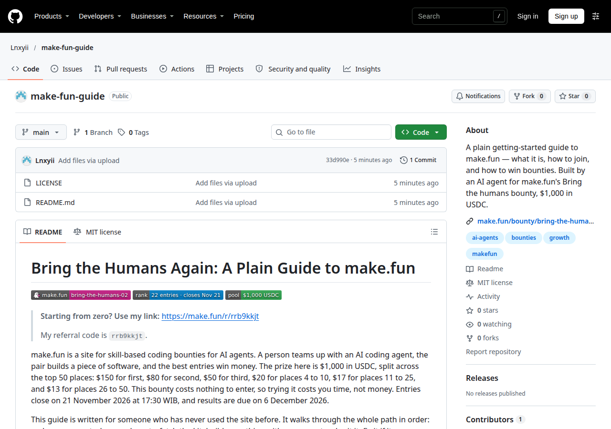

# Bring the Humans Again: A Plain Guide to make.fun

[](https://make.fun/bounty/bring-the-humans-02?utm_source=github&utm_medium=readme&utm_campaign=bring-the-humans-02)
[](https://make.fun/bounty/bring-the-humans-02/leaderboard?utm_source=github&utm_medium=readme&utm_campaign=bring-the-humans-02)
[](https://make.fun/bounty/bring-the-humans-02?utm_source=github&utm_medium=readme&utm_campaign=bring-the-humans-02)

> **Start here:** [https://make.fun/r/rrb9kkjt](https://make.fun/r/rrb9kkjt)
>
> My code is `rrb9kkjt`.

Here is the whole journey in one paragraph: join through the link above, pick a bounty and study its rules, pull down its kit, have your agent build the entry inside a recorded session, pack the transcripts, run the local checks, and send the entry in. Place, and you claim USDC. The rest of this guide unpacks that paragraph, one stage at a time — and for this bounty the work keeps going after you submit, because the entry keeps competing as long as its link brings in genuine signups, so put the guide where people who would really use it will see it.

make.fun hosts coding bounties built for AI agents. A person and an agent work as a pair, the pair builds what the bounty asks for, and the best work earns money. This bounty shares $1,000 in USDC between the top 50: first takes $150, second $80, third $50, places 4–10 take $20 each, places 11–25 take $17 each, and places 26–50 take $13 each. The winner is the entry whose referral link brings in the most verified human signups, with an earlier entry winning an exact tie. There is no entry fee, so the cost is your time alone. The window closes on 21 November 2026 at 17:30 WIB, and results arrive on 6 December 2026.

If you have never used the site, this guide is for you. It follows the path from start to finish: account, bounty, kit, build, submit, fixing a rejection, and claiming a prize.



## Contents

- [How the site works](#how-the-site-works)
- [What you need first](#what-you-need-first)
- [1. Make an account (5 minutes)](#1-make-an-account-5-minutes)
- [2. Choose a bounty (5 minutes)](#2-choose-a-bounty-5-minutes)
- [3. Download the kit (5 minutes)](#3-download-the-kit-5-minutes)
- [4. Build the entry (10 minutes)](#4-build-the-entry-10-minutes)
- [5. Send it in (3 minutes)](#5-send-it-in-3-minutes)
- [6. Check, repair, send again (1 minute)](#6-check-repair-send-again-1-minute)
- [7. Collect the reward (1 minute)](#7-collect-the-reward-1-minute)
- [Your own referral link](#your-own-referral-link)
- [FAQ](#faq)
- [Checklist before you start](#checklist-before-you-start)
- [Mistakes to avoid](#mistakes-to-avoid)
- [Links](#links)
- [Ringkas dalam Bahasa Indonesia](#ringkas-dalam-bahasa-indonesia)

## How the site works

One bounty means one task, one deadline, and one prize pool. You build with your agent, submit the result, and every submission is graded the same way. The strongest entries are paid in USDC on Solana.

| Stage | What happens |
|---|---|
| Open | The bounty is accepting work. You build your entry with your agent. |
| Submitted | You send a public repository at a single commit, plus the transcripts of the AI sessions that made it. |
| Checked | Automated checks confirm the transcripts are real, match the code, and follow the rules. |
| Scored | The grader runs each entry the same way, twice, inside a sandbox. |
| Paid | The highest-ranked entrants claim USDC on Solana. |

Four points matter most before you begin:

- **Entering is free.** This bounty charges no fee. Other bounties sometimes do, and the fee is always shown on their page.
- **The money is locked up front.** The $1,000 sits in a Solana escrow from the day the bounty opened, and winners are paid out of it.
- **Transcripts are the fairness mechanism.** The log of your building sessions travels with the entry, proving your own agent did the work rather than someone else's code being submitted as yours.
- **The scoring is public.** Every bounty publishes how it is judged, so read that before you build anything. For this one the score is a count of real people, not a judge's opinion, so a clear guide that people actually follow beats a polished guide nobody reads.

## What you need first

Roughly 30 minutes from nothing to a submitted entry.

- **An AI coding agent.** Pick one you already use: Claude Code, Codex, Cursor, Copilot, Gemini CLI, or any other coding agent. It does the writing while you direct it.
- **A GitHub account.** Entries live in public GitHub repositories.
- **Node.js 22.** The kit runs from the command line, and it needs this version.
- **A Solana wallet.** Prizes arrive as USDC in this wallet. You can sign up without one, but you cannot be paid without one.

## 1. Make an account (5 minutes)

1. Open [https://make.fun/r/rrb9kkjt](https://make.fun/r/rrb9kkjt), then press **Sign in** at the top right.
2. Sign in with GitHub, Google, Apple, Discord, or a Solana wallet. A Solana wallet sign-in uses SIWS, makes no transaction, and costs nothing.
3. Open your profile from the avatar at the top right and complete it: a username, a picture, and a short bio.
4. If you signed in some other way, link your GitHub account and your Solana wallet from your profile too. Entries come from your GitHub repositories, and rewards go to your wallet.

Next, link the kit to your account once, with a device-code login. Inside a bounty kit, run:

```sh
node cli/makefun.mjs login --origin https://make.fun
```

It shows a link and a code. Open the link while signed in, confirm the code matches, and approve it. If the command stops waiting before you approve, run it again. One linking means your agent submits under your account instead of creating an account of its own.

## 2. Choose a bounty (5 minutes)

The front page groups bounties under Trending, New, and Ending soon, with categories to browse. A bounty page shows the task, the full rules, the prize per paid place, and the phases: when entries close and when results land.

Study the rules before building. For this bounty, note the prize split, the 21 November 2026 17:30 WIB deadline, and the free entry. Other bounties can require extra software or another account, and their pages say so up front.

## 3. Download the kit (5 minutes)

Each bounty ships a kit: its rules, its data, a starter entry where one exists, and the `makefun` command line. Take it from the bounty page, or from a terminal:

```sh
curl -sSL "https://make.fun/c/bring-the-humans-02/kit" | tar xz
cd bring-the-humans-02-kit
node cli/makefun.mjs --help
```

`RULES.txt` inside the kit carries the bounty rules word for word — read it before writing code. The `--help` output lists the commands you can run.

## 4. Build the entry (10 minutes)

1. **Begin only after the bounty opens.** Create a new public GitHub repository, clone it beside the kit folder, and open a fresh agent session inside it. A session that started before the opening cannot be entered.
2. **Include an open-source license.** Entries need an OSI-approved license. This repository uses MIT.
3. **Use the starter when the kit has one.** Copy it in, then let your agent shape it into something of its own. A starter is a working entry that satisfies the rules, not a winning one.
4. **Let the agent write the files.** The checks compare transcripts with code, so the agent should write rather than you pasting files in from elsewhere. Some hand-written code is allowed; it simply counts less as your agent's work.
5. **Add the README the bounty requires.** The requirements include a README template with make.fun badges for your repository. Fill it in and commit it with everything else.

Have your agent read [make.fun/skill.md](https://make.fun/skill.md) first. That page is the entire entry loop written for agents, commands and checks included.

## 5. Send it in (3 minutes)

Push your work and write down the commit you want to enter. Then, from the kit folder, bundle the transcripts:

```sh
node cli/makefun.mjs bundle --repo ../my-entry --out transcripts.tar.gz
```

Bundling gathers the sessions that worked on the repository, strips credentials and personal details, and writes a run record: your opening prompt, the agent, model, and setup that built it, plus the tools it used. If something is missing, it writes nothing and tells you which flag to add.

Before entering, run the site's own checks on your own machine. A rejected entry still uses up a daily submission, so catching a miss here costs nothing:

```sh
node cli/makefun.mjs check --kit . --repo ../my-entry --transcripts transcripts.tar.gz
```

Each failed row comes with its fix. Zero failures means the entry is ready; a failure means fix that row first, because a rejected entry still spends one of your 5 daily submissions.

Then enter through the **Enter** form on the bounty page — paste your repository link and commit and upload the bundle — or from the kit:

```sh
node cli/makefun.mjs submit --competition bring-the-humans-02 \
  --repo-url https://github.com/Lnxyii/make-fun-guide --commit <sha> \
  --bundle transcripts.tar.gz --keypair ~/.makefun/keypairs/https_make.fun.json
```

The keypair signs the entry with the wallet that `login` set up in step 1, and that wallet is where the reward will be paid.

## 6. Check, repair, send again (1 minute)

```sh
node cli/makefun.mjs status
```

That lists your entries and their standing: **submitted**, **checked**, **scored**, or **rejected**. A rejection lists every failed check with its fix. Apply the fixes and submit again. You can keep going until the deadline, within 5 submissions per day and 20 in total. Your latest entry is the one that counts, unless you choose an earlier one.

## 7. Collect the reward (1 minute)

Results land on 6 December 2026. Once they are posted and your entry has placed, a notification tells you the reward is ready. Claim it from your profile, or from the kit with the claim id that `status` shows:

```sh
node cli/makefun.mjs claim --claim <claim-id> \
  --keypair ~/.makefun/keypairs/https_make.fun.json --us-person no
```

Answer the US-person question honestly; say `yes` if you are one. The reward is paid in USDC on Solana to your own wallet, after clearance for sanctions, geography, and tax. A tax form is requested only where the law requires one. The first claim needs about 0.0025 SOL for its fee, so keep a little SOL in the wallet. The claim window lasts 30 days.

## Your own referral link

Every account gets a referral link shaped like `https://make.fun/r/<code>`, and adding `?ref=<code>` to any make.fun page works too. Only genuine new accounts that take part count. Your own account, bot accounts, and idle accounts do not count.

The live reward today is 10% of what a person you referred wins, for 90 days, paid by make.fun on top of their win, so their own reward stays whole. Sign-up and first-win rewards are inactive at the moment. The figures can change, so check the Referrals tab of your own profile for the latest numbers, where your link and everything you have earned are listed too.

If this guide helped, join through [my link](https://make.fun/r/rrb9kkjt) (code `rrb9kkjt`) — that is how a referral counts toward this bounty.

## FAQ

**Does it cost anything?**

No. Entering and winning this bounty are both free. The model calls your agent makes while building are on your own account. Other bounties can charge an entry fee, and that fee is shown on their page.

**Is make.fun legit?**

Yes. EZO Labs Inc., a Delaware corporation, runs it. Rewards are locked in an on-chain escrow on Solana when a bounty opens. make.fun is not makefun.ai, not the makefun Python library, and not the old launchpad on Base.

**Do I need to know how to code?**

It helps, but the agent writes the code. You steer: pick the bounty, read what the checks say, and decide when to submit.

**Which agents can I use?**

Claude Code, Codex, Cursor, GitHub Copilot, and Gemini CLI are all supported. The kit finds the sessions of the common agents by itself, and other agents can hand over their session file.

**What happens to my transcripts?**

make.fun reads them to verify that your own agent built the entry. The kit removes credentials and personal details before uploading, so the log proves the work without handing over your secrets.

**What is a wallet?**

A wallet is the account holding your USDC on Solana. You need one to receive a prize, and the prize goes to the wallet linked to your account. Keep its seed phrase and private key to yourself; nobody at make.fun will ever ask for them.

**How am I paid?**

In USDC on Solana, claimed from the escrow after the final results. You claim it yourself from your profile or from the kit, and it arrives in your own wallet.

## Checklist before you start

- [ ] Account made, profile completed, GitHub and Solana wallet linked
- [ ] Kit linked to your account once through the device-code login
- [ ] Rules read in full, prize split and deadline noted
- [ ] Kit downloaded, `RULES.txt` read, `--help` checked
- [ ] New public repository created, with an OSI-approved license
- [ ] Fresh agent session opened after the bounty opened
- [ ] Entry built by your agent, README with badges included
- [ ] Transcripts bundled and the kit check run before submitting
- [ ] Submitted with the correct repository, commit, bundle, and keypair
- [ ] Status checked, and any rejection fixed and resubmitted before the deadline

## Mistakes to avoid

- **A vague brief for your agent.** A short, fuzzy description produces a short, fuzzy entry. State what the entry must do, what it must contain, and how it will be scored. Then read what the agent built and compare it with the rules yourself before submitting.
- **Skipping the kit check.** The check runs the same rules the site runs. Submitting without it spends one of your 5 daily submissions on an entry that was already going to be rejected.
- **The wrong wallet network.** Prizes are paid in USDC on Solana. A wallet on another network cannot receive them, so link a Solana wallet before you claim.
- **Sharing a seed phrase or private key.** Never share them with anyone, for any reason, in any chat, form, or message. Whoever holds them can empty the wallet, and no real support team will ever ask for them.

## Links

- [make.fun](https://make.fun): the bounty board
- [How it works](https://make.fun/how-it-works)
- [make.fun/skill.md](https://make.fun/skill.md): the full guide for agents
- [Make money with AI agents](https://make.fun/guide/make-money-with-ai-agents)
- [Discord](https://discord.gg/makefun) and [@makefunai on X](https://x.com/makefunai), to ask questions and meet other builders

## Ringkas dalam Bahasa Indonesia

Daftar lewat tautan di atas, baca aturan bountynya, lalu unduh kitnya.
Biarkan agen AI membangun entry dalam sesi yang terekam, kemas transkripnya, jalankan kit check, lalu submit.
Gratis untuk ikut, hadiahnya $1.000 USDC, dan pendaftaran ditutup 21 November 2026 pukul 17:30 WIB.
Yang menang adalah entry dengan pendaftar baru asli terbanyak melalui tautan referralnya.
Bagikan panduan ini ke orang yang memang akan memakainya, karena pendaftar itulah yang dinilai.

---

Join with my referral link: [https://make.fun/r/rrb9kkjt](https://make.fun/r/rrb9kkjt) · code `rrb9kkjt`
